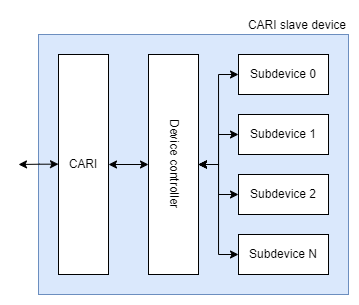
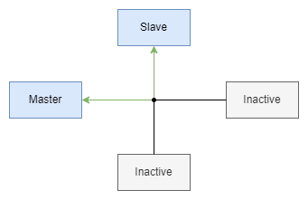
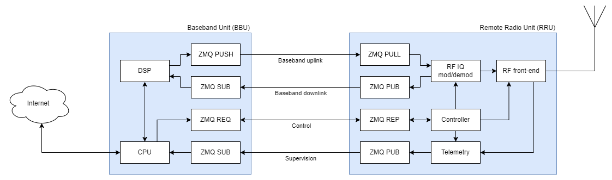
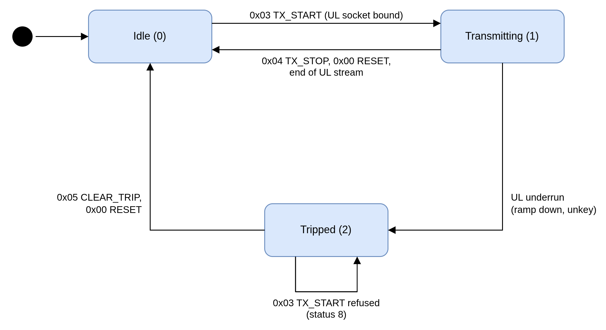
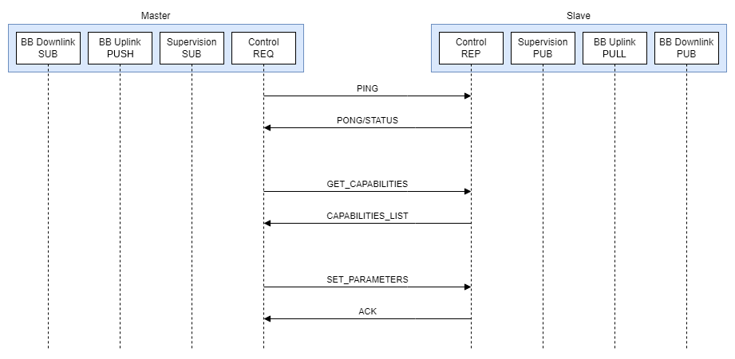
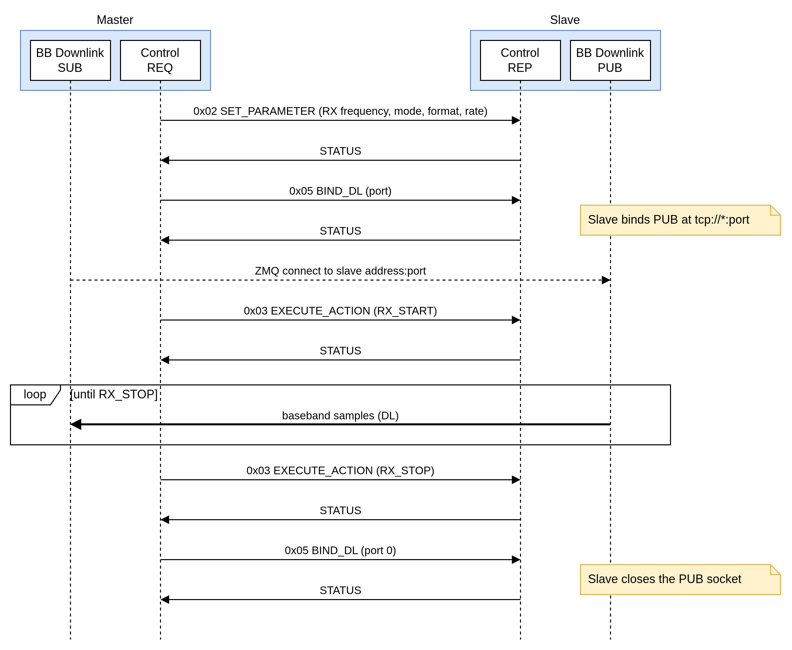
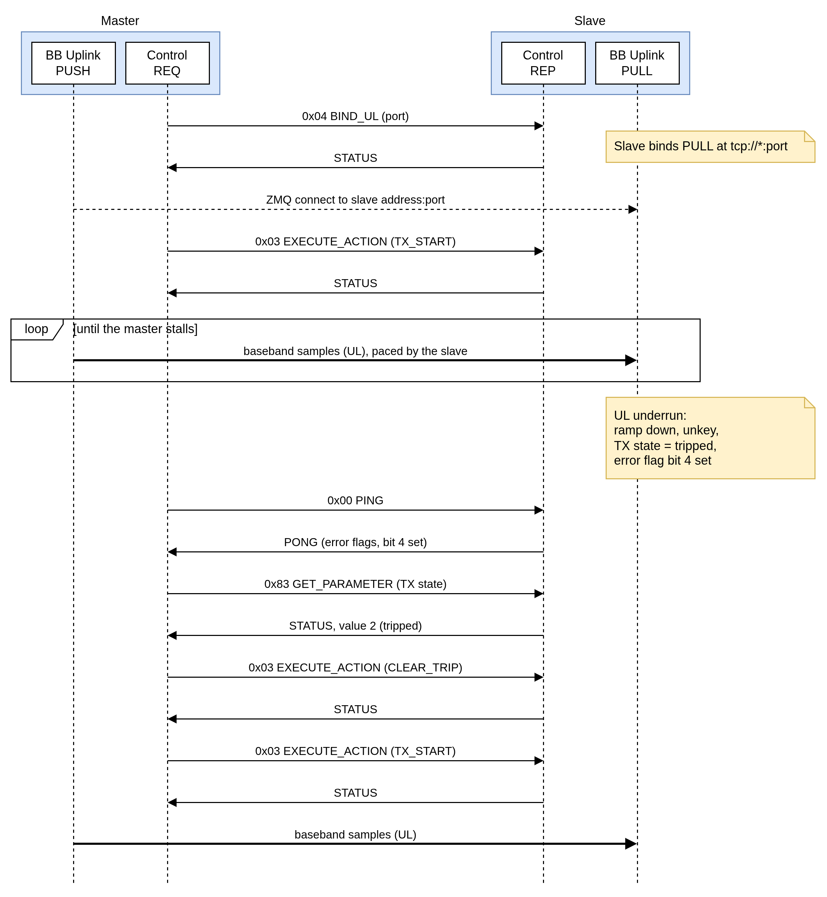

# Common Amateur Radio Interface (CARI)
**Author:** 
Wojciech Kaczmarski, SP5WWP 
M17 Foundation 
10 October 2026

## Protocol revision
The protocol described in this document is **CARI 2.0**.

**Note:** CARI 2.0 is not backward compatible with CARI 1.x. See **Changes from CARI 1.x** at the end of this document.

## Abbreviations used in this document
BB   - Baseband 
BBU  - Baseband Unit 
CARI - Common Amateur Radio Interface 
CID  - Command Identifier 
CPRI - Common Public Radio Interface 
DL   - Downlink 
FLAC - Free Lossless Audio Codec 
HWM  - High-Water Mark (ZeroMQ queue limit) 
LNA  - Low Noise Amplifier 
LSB  - Lower Sideband 
PA   - Power Amplifier 
PUB  - Publisher (ZeroMQ socket type) 
PULL - Pull (ZeroMQ socket type) 
PUSH - Push (ZeroMQ socket type) 
REP  - Reply (ZeroMQ socket type) 
REQ  - Request (ZeroMQ socket type) 
RL   - Return Loss 
RRU  - Remote Radio Unit 
SUB  - Subscriber (ZeroMQ socket type) 
TLV  - Type-Length-Value 
UL   - Uplink 
USB  - Upper Sideband 
ZMQ  - ZeroMQ 

## Introduction
CARI protocol is designed to mimic professionally used *Common Public Radio Interface* (CPRI)
and offer a part of its functionality.
The protocol allows for basic data, control and supervision plane access, letting the user directly control
radio devices over a given medium. [ZeroMQ](https://zeromq.org/) is used for all data transfers. 

### Devices
A *CARI device* is any electronic device capable of supporting these functions:
* bi-directional medium access (mandatory for all devices)
* translation of digital signals into radio frequency domain and *vice versa* (mandatory for slaves)

Therefore, a RRU (slave) will combine both, while the BBU (master) will support only the first function.
Devices can be either masters or slaves, role mixing is not possible (one role per device).

### Subdevices
Transmitters and receivers within a single slave device are called *subdevices*.
There can be a maximum of 255 subdevices per device. Subdevices use addresses from 0x00 to 0xFE (inclusive).
The address of 0xFF is reserved.

**Figure 1** - Device structure

### Basic topology
The interface assumes there are at least two devices connected over some physical medium:
* at least one master
* at least one controlled device (slave)

The connection between two or more devices is called a *network*.
A single network can consist of multiple masters and slaves.
A slave has no notion of ownership - it executes commands from any master.
Coordinating multiple masters controlling the same slave is out of scope of this document.
Since there is no device addressing, the physical layer must be able to provide it.

**Figure 2** - Basic master-slave transaction

### Data flow and the Planes
There are 4 paths for the data flow, called *planes*:
* baseband downlink (*DL*) - baseband samples flowing from the slave to the master (received signals)
* baseband uplink (*UL*) - baseband samples flowing from the master to the slave (signals to be transmitted)
* control (*CTRL*)
* supervision (*SPVN*)

**Note:** The direction naming differs from CPRI, where *downlink* denotes the BBU->RRU direction.

#### Baseband downlink/uplink
Connections through the downlink and uplink planes can be established only when required.
Each subdevice has its own DL and/or UL stream, so a multi-subdevice device can have more than one pair of baseband streams.
For both planes, the slave binds and the master connects:

| Plane | Slave socket (binds) | Master socket (connects) |
|-------|----------------------|--------------------------|
| DL    | PUB                  | SUB                      |
| UL    | PULL                 | PUSH                     |

**Table 1** - Baseband socket types

DL uses a PUB-SUB pair, so more than one master (e.g. a BBU and a monitoring station) may receive the same stream.
The slave never waits for a slow or absent master - messages that cannot be delivered are dropped.

UL uses a PUSH-PULL pair. The slave shall read UL samples from its socket only as fast as it transmits them,
so that a master producing samples too fast is held back by ZMQ flow control (its send operation blocks).
This makes the slave's sample clock the timing reference for the UL plane - the master does not need to pace the samples itself.
Only one master shall connect to a given subdevice's UL socket. Samples from multiple senders would be interleaved.

Sockets are bound with CID 0x04 (UL) and CID 0x05 (DL). The format of the data is described in **Baseband data format**.

#### Data transactions over the Control Plane (CTRL)
A *data transaction* is any event of data exchange between the master and a slave device.
It consists of a *command* and a *reply*.

Control plane is used for setting radio equipment's parameters, such as oscillators' frequencies and RF signals' power levels.
This path uses a ZMQ REQ-REP pair. 

**Note:** CARI connection type over the Control Plane is point-to-point. Only one slave device can be addressed within a single transaction.
To set desired parameters of multiple devices, it is required to issue several commands.

**Note:** Each slave shall expose a dedicated CTRL REP endpoint. Device selection is performed by endpoint selection, not by protocol-level addressing.

#### Supervision
Supervision plane gives access to various telemetry data, including chassis temperature, reflected RF power, RL, etc.
The slave device offers telemetry data over its ZMQ PUB socket (bound with CID 0x06), the master connects a SUB socket. 

#### Example master-slave connection
In the example below, the Baseband Unit (BBU) acts as a master over the Remote Radio Unit (RRU).

**Figure 3** - Example master-slave connection

### Command-reply
A *command* is a sequence of bytes sent by the master device, executing a particular action
at the controlled device. Every command has a command identifier (*CID*) assigned to it. 
A *reply* is a sequence sent back by the controlled device. Every reply carries a status code
and, on success, optional data. 
Subdevices can be accessed independently and are addressed using a single byte.

**Note:** 32-bit IEEE-754 floating point values are used wherever *float* is mentioned.
All multi-byte values are little-endian, unless specified otherwise.

#### Command format
| CID        | Byte count field |
|------------|------------------|
| 1 byte     | 2 bytes          |

**Table 2** - Command with no addressing or parameters (e.g. *Ping*)

| CID        | Byte count field | Parameters       |
|------------|------------------|------------------|
| 1 byte     | 2 bytes          | 0 .. 65532 bytes |

**Table 3** - Command with parameters

| CID        | Byte count field | Address* | Parameters       |
|------------|------------------|----------|------------------|
| 1 byte     | 2 bytes          | 1 byte   | 0 .. 65531 bytes |

**Table 4** - Command with addressing and parameters

\*Address of either a register or subdevice.

#### Reply format
| CID        | Byte count field | Status   | Data             |
|------------|------------------|----------|------------------|
| 1 byte     | 2 bytes          | 1 byte   | 0 .. 65531 bytes |

**Table 5** - Reply

The reply uses the same CID as the command, even if the received CID is invalid.
*Status* is 0 on success, any other value is an error code (see **Table 9**).
*Data* is present only if the status is 0 - an error reply is always 4 bytes long.
Replies do not repeat the address or any other command parameter.

Byte count is little-endian and includes **all** bytes in the sequence, including the CID.

#### Reply rules
* The slave shall send exactly one reply for every message received over the CTRL plane. A missing reply leaves the master's REQ socket unable to send further commands.
* A message shorter than 3 bytes, a message whose byte count field does not match its actual length,
or a command whose length does not match the length expected for its CID is malformed. The slave shall reply with status 1.
The reply CID is the first byte of the received message, or 0xFF if the message is empty.
* A command with an unknown CID shall be answered with status 2.

### Command list
Commands are divided into 2 types: *WRITE* and *READ*.

| Type    | CID range  |
|---------|------------|
| *WRITE* | 0x00..0x7F |
| *READ*  | 0x80..0xFF |

**Table 6** - Command types

| CID     | Byte count | Action                                | Address    | Parameters                                                  | Reply data (on success)        | Reply byte count (on success) |
|---------|------------|---------------------------------------|------------|-------------------------------------------------------------|--------------------------------|-------------------------------|
| 0x00    | 3          | Ping/Pong                             | -          | -                                                           | 32-bit error flags (Table 10)  | 8                             |
| 0x01    | 5          | Set device's register value*          | register   | 8-bit value                                                 | -                              | 4                             |
| 0x02    | 5 + n      | Set subdevice's parameter             | subdevice  | 8-bit parameter ID, value (n bytes, see Table 15)           | -                              | 4                             |
| 0x03    | 5          | Execute subdevice's action            | subdevice  | 8-bit action ID                                             | -                              | 4                             |
| 0x04    | 6          | Bind BB UL PULL socket**              | subdevice  | 16-bit port number                                          | -                              | 4                             |
| 0x05    | 6          | Bind BB DL PUB socket**               | subdevice  | 16-bit port number                                          | -                              | 4                             |
| 0x06    | 7 + n      | Bind Supervision PUB socket***        | -          | 16-bit port number, 16-bit period (ms), n quantity IDs      | -                              | 4                             |

**Table 7** - *WRITE* command list

\*Writing any value to register 0x00 using CID=0x01 shall initiate device's reset (see **Config/info register access**). 
\**The slave binds the socket on all interfaces at the given TCP port (`tcp://*:<port>`).
The master obtains the slave's network address from the already established CTRL connection to that device.
After a successful reply, the master connects its counterpart socket (**Table 1**) to that same address on the port it specified.
Issuing the command again with a different port closes the previous socket and binds a new one. Port 0 closes the socket.
A socket can be rebound or closed only while its stream is stopped, otherwise the slave shall reply with status 8. 
\***The slave publishes the listed quantities (**Table 20**) every *period* milliseconds. Period 0 is out of range (status 5).
An empty quantity list or port 0 stops publishing and closes the socket. Issuing the command again replaces the previous configuration.

| CID     | Byte count | Action                                | Address    | Parameters           | Reply data (on success)                    | Reply byte count (on success) |
|---------|------------|---------------------------------------|------------|----------------------|--------------------------------------------|-------------------------------|
| 0x80    | 3          | Get *IDENT* string                    | -          | -                    | *IDENT* string (n bytes)                   | 4 + n                         |
| 0x81    | 4          | Get register value                    | register   | -                    | 8-bit value                                | 5                             |
| 0x82    | 4          | Get subdevice capabilities list       | subdevice  | -                    | capability records (Table 12)              | varies                        |
| 0x83    | 5          | Get subdevice parameter               | subdevice  | 8-bit parameter ID   | parameter value (n bytes, see Table 15)    | 4 + n                         |
| 0x84    | 3          | Get Supervision quantities list       | -          | -                    | n supported quantity IDs (Table 20)        | 4 + n                         |
| 0x85    | 3          | Get device capabilities list          | -          | -                    | capability records (Table 12)              | varies                        |

**Table 8** - *READ* command list

**Note:** The *IDENT* string shall be UTF-8 encoded. It is not null-terminated.

### Reply status codes
| Value    | Meaning                                                              |
|----------|----------------------------------------------------------------------|
| 0        | No errors                                                            |
| 1        | Malformed frame                                                      |
| 2        | Unsupported command, parameter, action or quantity                   |
| 3        | ZMQ port bind failed                                                 |
| 4        | Reserved                                                             |
| 5        | Value out of range                                                   |
| 6        | Invalid address (no such subdevice or register)                      |
| 7        | Read-only                                                            |
| 8        | Invalid state (the request is not allowed in the current state)      |
| 9 .. 255 | Reserved                                                             |

**Table 9** - Reply status codes

### Device error flags
The error flags are returned in the *Pong* reply (CID 0x00).

| Bit                     | Meaning                                        |
|-------------------------|------------------------------------------------|
| 0 (least significant)   | PLL lock error                                 |
| 1                       | Subdevice communication error                  |
| 2                       | Temperature out of allowed range               |
| 3                       | Frequency reference unavailable                |
| 4                       | UL underrun trip*                              |
| 5 .. 30                 | Reserved                                       |
| 31 (most significant)   | Reserved                                       |

**Table 10** - Device error flags

\*Set while at least one subdevice is in the *tripped* state (see **UL underrun handling**).
Cleared when no subdevice remains tripped. Reading the flags does not clear it.

### Config/info register access
**Note:** Some registers are read-only. All values are 8-bit (single byte).

| Register address | Description                           | Access |
|------------------|---------------------------------------|--------|
| 0x00             | CARI version support                  | R/W*   |
| 0x01             | Number of subdevices                  | R      |
| 0x02 .. 0xFF     | User-defined space                    | R/W    |

**Table 11** - Register address map

\*Writing any value to register 0x00 shall initiate device's reset. The slave sends the reply first, then resets. 
A device reset stops all streams and closes all baseband and supervision sockets. 

Writing a read-only register returns status 7. Accessing a register the device does not implement returns status 6.

#### CARI version support
This field holds supported CARI protocol version as `(major<<4)|minor`. For CARI 2.0 the value is 0x20.

### Capabilities
#### Capability list encoding
Capability lists (CID 0x82 and 0x85) consist of consecutive capability records:

| Capability ID | Length | Value          |
|---------------|--------|----------------|
| 1 byte        | 1 byte | Length bytes   |

**Table 12** - Capability record

*Explicit* capabilities (IDs 0x00..0x7F) have no value - their length is 0 and the presence of the record means the capability is available.
*Ranged* capabilities (IDs 0x80..0xFF) carry a value of the size and type given in **Table 14b**.

A receiver shall skip records with an unknown capability ID, using the length field.

#### Device's capabilities
| Capability ID | Meaning                                      |
|---------------|----------------------------------------------|
| 0x00          | Baseband stream compression available        |
| 0x01          | Supervision channel available                |
| 0x02 .. 0xFF  | Reserved                                     |

**Table 13** - Capabilities (device)

#### Subdevice's capabilities
| Capability ID | Meaning                                      |
|---------------|----------------------------------------------|
| 0x00          | Subdevice can be reset                       |
| 0x01          | I/Q modulation available                     |
| 0x02          | Receiver                                     |
| 0x03          | Transmitter                                  |
| 0x04          | Full duplex available                        |
| 0x05          | Automatic Gain Control available             |
| 0x06          | Automatic Frequency Control available        |
| 0x07          | Frequency reference available                |
|               |                                              |
| 0x08          | Amplitude demodulator available              |
| 0x09          | Frequency demodulator available              |
| 0x0A          | Phase demodulator available                  |
| 0x0B          | Upper sideband demodulator available         |
| 0x0C          | Lower sideband demodulator available         |
|               |                                              |
| 0x0D          | Amplitude modulator available                |
| 0x0E          | Frequency modulator available                |
| 0x0F          | Phase modulator available                    |
| 0x10          | Upper sideband modulator available           |
| 0x11          | Lower sideband modulator available           |
|               |                                              |
| 0x12          | DC offset correction available               |
| 0x13 .. 0x3F  | Reserved                                     |
|               |                                              |
| 0x40          | Signal format CF32 available                 |
| 0x41          | Signal format CS16 available                 |
| 0x42          | Signal format F32 available                  |
| 0x43          | Signal format S16 available                  |
| 0x44          | Signal format CS8 available                  |
| 0x45          | Signal format S8 available                   |
| 0x46          | Signal format CU8 available                  |
| 0x47          | Signal format U8 available                   |
| 0x48 .. 0x7F  | Reserved                                     |

**Table 14a** - Explicit capabilities (subdevice)

Signal formats are described in **Table 18**.

| Capability ID | Meaning              | Unit         | Size (bytes)   |
|---------------|----------------------|--------------|----------------|
| 0x80          | Receive frequency    | Hz           | 8 (unsigned)   |
| 0x81          | Transmit frequency   | Hz           | 8 (unsigned)   |
| 0x82          | LNA gain             | dB           | 4 (float)      |
| 0x83          | Output power         | dBm          | 4 (float)      |
| 0x84          | Channel width        | Hz           | 4 (float)      |
| 0x85          | Sample rate          | Hz           | 4 (float)      |
| 0x86          | FM deviation         | Hz           | 4 (float)      |
| 0x87          | PM deviation         | rad          | 4 (float)      |
| 0x88 .. 0xFF  | Reserved             | -            | -              |

**Table 14b** - Ranged capabilities (subdevice)

#### Expressing value ranges
Ranged capabilities are always transmitted in pairs of records with the same capability ID - the lower bound first, then the upper bound:

`... | Capability ID | Length | Value - low | Capability ID | Length | Value - high | ...`

A single supported value is expressed as a pair with equal bounds.
Multiple pairs with the same capability ID may be transmitted to express disjoint ranges (e.g. two frequency bands).

### Subdevice parameters
Parameters are used to configure subdevices.

| Parameter ID  | Meaning                                      | Size (bytes)   | Unit     |
|---------------|----------------------------------------------|----------------|----------|
| 0x00          | Receive frequency                            | 8 (unsigned)   | Hz       |
| 0x01          | Transmit frequency                           | 8 (unsigned)   | Hz       |
| 0x02          | LNA gain                                     | 4 (float)      | dB       |
| 0x03          | Output power                                 | 4 (float)      | dBm      |
| 0x04          | Channel width                                | 4 (float)      | Hz       |
| 0x05          | Sample rate                                  | 4 (float)      | Hz       |
| 0x06          | Frequency correction                         | 4 (float)      | ppm      |
| 0x07          | Automatic Gain Control (AGC)                 | 1 (boolean)    | -        |
| 0x08          | Automatic Frequency Control (AFC)            | 1 (boolean)    | -        |
| 0x09          | DC offset correction                         | 1 (boolean)    | -        |
| 0x0A          | Signal format*                               | 1 (unsigned)   | -        |
| 0x0B          | Modulation mode (Table 16)                   | 1 (unsigned)   | -        |
| 0x0C          | Deviation**                                  | 4 (float)      | Hz / rad |
| 0x0D          | Baseband compression***                      | 1 (boolean)    | -        |
| 0x0E          | TX state (read-only, Table 17b)              | 1 (unsigned)   | -        |
| 0x0F .. 0xFF  | Reserved                                     | -              | -        |

**Table 15** - Subdevice parameters

\*The value is the signal format's capability ID from **Table 14a** (0x40..0x47). 
\**Peak frequency deviation in Hz for FM, peak phase deviation in radians for PM. Not used in other modes. 
\***Requires device capability 0x00. See **Compressed baseband**.

For boolean parameters, 0 disables the function, while 1 enables it. Any other value is out of range (status 5).

Parameter rules:
* A value outside the subdevice's supported range, or an unsupported signal format or modulation mode, returns status 5.
* A parameter the subdevice does not support (e.g. transmit frequency on a receive-only subdevice) returns status 2.
* Writing the TX state parameter returns status 7.
* Signal format, sample rate, modulation mode and baseband compression shall not be changed while the subdevice's DL or UL stream is running. Such an attempt returns status 8.
Other parameters (e.g. frequencies, gain, power) may be changed at any time.
* The combination of parameters is checked when a stream is started (actions 0x01 and 0x03). If it is not valid, the start is refused with status 8. Valid combinations:
  * the I/Q modulation mode requires a complex signal format, all other modes require a real signal format,
  * baseband compression requires an integer signal format and a sample rate that can be represented in a FLAC frame header (see **Compressed baseband**).

### Modulation modes
| Value         | Modulation mode                              |
|---------------|----------------------------------------------|
| 0x00          | I/Q (no modulation/demodulation)             |
| 0x01          | AM                                           |
| 0x02          | FM                                           |
| 0x03          | PM                                           |
| 0x04          | USB                                          |
| 0x05          | LSB                                          |
| 0x06 .. 0xFF  | Reserved                                     |

**Table 16** - Modulation modes

### Subdevice actions
| Action ID     | Action                                     |
|---------------|--------------------------------------------|
| 0x00          | Subdevice reset                            |
| 0x01          | Reception start (start baseband DL)        |
| 0x02          | Reception stop (stop baseband DL)          |
| 0x03          | Transmission start (start baseband UL)     |
| 0x04          | Transmission stop (stop baseband UL)       |
| 0x05          | Clear UL underrun trip                     |
| 0x06 .. 0xFF  | Reserved                                   |

**Table 17a** - Subdevice actions

* Reset stops reception and transmission and clears a trip. Bound sockets remain bound. Parameter values after a reset are device-specific.
* An action the subdevice does not support (e.g. reset without capability 0x00, or transmission start on a receive-only subdevice) returns status 2.
* Starting a stream requires its socket to be bound (CID 0x04 or 0x05), otherwise the slave replies with status 8.
* Starting a running stream or stopping a stopped stream is not an error.
* Transmission start is refused with status 8 while the subdevice is tripped.
* Clearing a trip returns the subdevice to the idle TX state. Clearing a subdevice that is not tripped is not an error.
* Amplitude ramping at transmission start and stop is left to the slave.

The current TX state can be read with parameter 0x0E:

| Value | TX state      |
|-------|---------------|
| 0     | Idle          |
| 1     | Transmitting  |
| 2     | Tripped       |

**Table 17b** - TX states

**Figure 4** - TX state transitions

### Baseband data format
Each ZMQ message on the DL and UL planes carries an integer number of samples in the signal format selected with parameter 0x0A.
There is no header - messages contain baseband data only. Multi-byte components are little-endian.
For complex formats, a sample consists of the real (I) component followed by the imaginary (Q) component.

| ID    | Format | Type                     | Bytes per sample |
|-------|--------|--------------------------|------------------|
| 0x40  | CF32   | complex, 32-bit float    | 8                |
| 0x41  | CS16   | complex, 16-bit signed   | 4                |
| 0x42  | F32    | real, 32-bit float       | 4                |
| 0x43  | S16    | real, 16-bit signed      | 2                |
| 0x44  | CS8    | complex, 8-bit signed    | 2                |
| 0x45  | S8     | real, 8-bit signed       | 1                |
| 0x46  | CU8    | complex, 8-bit unsigned  | 2                |
| 0x47  | U8     | real, 8-bit unsigned     | 1                |

**Table 18** - Signal formats

Format notation: C - complex, F - floating point, S - signed integer, U - unsigned integer.
The number denotes the bit size of either the real or the real/imaginary components.

#### Sample scaling
Samples are interpreted as normalized values *x* in the range [-1, +1):
* floating point formats: *x* is the value itself,
* signed *n*-bit formats: *x* = value / 2n-1,
* unsigned *n*-bit formats: *x* = (value - 2n-1) / 2n-1 (mid-scale is zero).

The meaning of *x* depends on the modulation mode:

| Mode | UL (transmit)                                                            | DL (receive)                                     |
|------|--------------------------------------------------------------------------|--------------------------------------------------|
| I/Q  | Complex baseband at the transmit frequency. \|x\| = 1 corresponds to the set output power | Complex baseband at the receive frequency, device-specific scaling |
| AM   | Envelope proportional to (1 + x), x = +-1 is 100% modulation depth       | Demodulated signal, same scale                   |
| FM   | Instantaneous frequency offset = x * deviation (Hz)                      | Demodulated signal, same scale                   |
| PM   | Instantaneous phase offset = x * deviation (rad)                         | Demodulated signal, same scale                   |
| USB/LSB | Audio-band signal, a full-scale sine wave corresponds to the set output power (PEP) | Demodulated audio, device-specific scaling |

**Table 19** - Sample meaning

#### UL underrun handling
An *underrun* occurs when a transmitting subdevice runs out of UL samples.
This should not happen in normal operation, as the slave paces the master (see **Baseband downlink/uplink**).
On an underrun, the slave shall:
1. ramp the output amplitude down to zero over the samples remaining in its buffer, to avoid an abrupt amplitude step at the PA,
2. stop transmitting (unkey),
3. put the subdevice in the *tripped* TX state and set the *UL underrun trip* flag (**Table 10**).

The master detects the trip with *Ping* (CID 0x00) and identifies the subdevice by reading its TX state (parameter 0x0E).
While tripped, the subdevice refuses transmission start. The trip is cleared explicitly with action 0x05 (or by a subdevice reset).

#### Compressed baseband
If the device offers capability 0x00 and baseband compression (parameter 0x0D) is enabled,
the baseband data is compressed with [FLAC](https://xiph.org/flac/format.html). The following rules apply to both DL and UL:
* Each ZMQ message contains one or more complete FLAC frames. The `fLaC` stream marker and metadata blocks (including STREAMINFO) are not transmitted.
The decoder is configured from the CTRL plane parameters instead.
* Only integer signal formats can be compressed. Complex formats are encoded as 2 channels (I, Q), real formats as 1 channel.
The FLAC bit depth equals the format's component size.
* Unsigned formats are offset by -2n-1 before encoding (FLAC samples are signed). The receiver adds 2n-1 back after decoding.
* Every frame header shall encode the sample rate and the bits per sample explicitly (not "get from STREAMINFO").
Therefore, the sample rate has to be an integer number of Hz, and either at most 65,535 Hz, or a multiple of 10 Hz up to 655,350 Hz.
* The block size is chosen by the encoder.
* A receiver joining an ongoing stream shall discard data until the first frame sync code.

**Note:** Every message carries complete frames, so the block size sets the minimum latency of a compressed stream
(e.g. 4096 samples take 170.7 ms at 24 kHz, but only 8.2 ms at 500 kHz).

### Supervision plane - data format
The data published over the Supervision Plane is grouped into packets: 
`Quantity ID | Value | Quantity ID | Value | ...` 
A packet with the quantities selected with CID 0x06 is published every *period* milliseconds.

For quantities requiring subdevice context (as indicated in **Table 20**),
the *Value* field shall be preceded by a 1-byte subdevice identifier,
resulting in the following encoding: 
`Quantity ID | Subdevice ID | Value` 
Such a quantity is published for every subdevice that supports it.

All *SPVN* packets are atomic ZMQ messages.
Quantities may appear in any order.
A given quantity shall not be repeated for the same context within a single packet.
For subdevice quantities, the context is defined by the subdevice identifier.

#### Quantities
| ID       | Quantity                         | Size (bytes)   | Unit        | Remarks                                                |
|----------|----------------------------------|----------------|-------------|--------------------------------------------------------|
| 0x00     | Temperature                      | 4 (float)      | deg. C      | Measured at the RF unit / chassis                      |
| 0x01     | Voltage                          | 4 (float)      | V           | Measured at the power supply input                     |
| 0x02     | Current                          | 4 (float)      | A           | Total current draw by the device, DC side              |
| 0x03     | Return Loss                      | 4 (float)      | dB          | The value has to be prepended with a subdevice address |
| 0x04     | RF power (incident, average)     | 4 (float)      | dBm         | The value has to be prepended with a subdevice address |
| 0x05     | RF power (reflected, average)    | 4 (float)      | dBm         | The value has to be prepended with a subdevice address |
| 0x06 .. 0xFF | Reserved                     | -              | -           | -                                                      |

**Table 20** - Supervision plane - supported quantities

## Implementation notes (informative)
* The master's SUB sockets (DL, SPVN) have to subscribe to all messages (empty `ZMQ_SUBSCRIBE` filter), otherwise nothing is received.
* PUB-SUB connections drop messages sent before the subscription reaches the publisher. A DL receiver should not expect the very first samples of a stream.
* PUSH queues messages until the connection is established, so UL samples sent right after connecting are not lost.
* The number of samples per DL message is chosen by the slave. A master cannot assume any particular message size.
* ZMQ high-water marks count messages, not bytes, and the operating system adds its own TCP buffers on both ends.
Large queues translate directly into latency - at low sample rates, the default settings can buffer several seconds of signal.
Keep `ZMQ_SNDHWM`/`ZMQ_RCVHWM` low and consider reducing `ZMQ_SNDBUF`/`ZMQ_RCVBUF` for the UL plane.
* A master should use a receive timeout on its REQ socket. If a reply does not arrive, the REQ socket has to be closed and reopened
(or `ZMQ_REQ_RELAXED` used) before sending another command.

## Example sequences (informative)
### Basic setup
Basic subdevice setup is shown in *Figure 5*.

**Figure 5** - Basic subdevice setup

### Reception
*Figure 6* shows a reception session. The master configures the subdevice, then asks the slave to bind the DL socket.
Only after a successful reply does the master connect its SUB socket. Reception is started and stopped with subdevice actions.
Binding port 0 closes the socket once the stream is stopped.

**Figure 6** - Reception

### Transmission and UL underrun recovery
*Figure 7* shows a transmission session with a UL underrun. While samples arrive, the slave paces the master.
When the master stalls, the slave ramps the output down, unkeys and trips. The master detects the trip with *Ping*,
finds the tripped subdevice by reading its TX state, clears the trip and starts the transmission again.

**Figure 7** - Transmission and UL underrun recovery

## Changes from CARI 1.x
* UL plane: the slave binds a PULL socket, the master connects a PUSH socket (previously PUB-SUB). CID 0x04 takes a port number and the slave binds.
* Every reply carries a status byte, followed by data only on success. *Pong* is 8 bytes long.
* Reply rules for malformed frames. New status codes 6 (invalid address), 7 (read-only) and 8 (invalid state).
* CID 0x06 has no address byte and takes a publishing period. CID 0x84 and 0x85 are 3 bytes long.
* Capability lists use TLV records. Ranged capabilities always come in pairs.
* Subdevice capabilities renumbered: separate USB/LSB modulators and demodulators, DC offset correction moved to 0x12,
new signal formats CS8, S8, CU8, U8, new ranged capabilities for FM and PM deviation.
* Signal format parameter moved from 0x10 to 0x0A. New parameters: modulation mode, deviation, baseband compression, TX state.
* Defined baseband data format, sample scaling and FLAC compression.
* UL underrun handling: trip, error flag bit 4, action 0x05 to clear it.
* Status code 4 (ZMQ connection failed) is reserved - the slave never connects in CARI 2.0.
